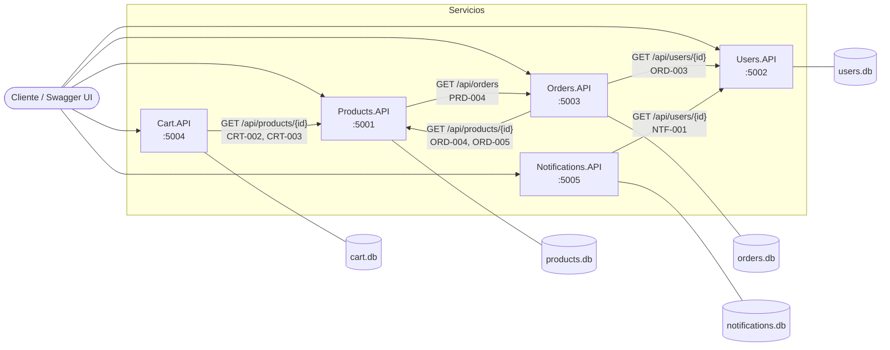
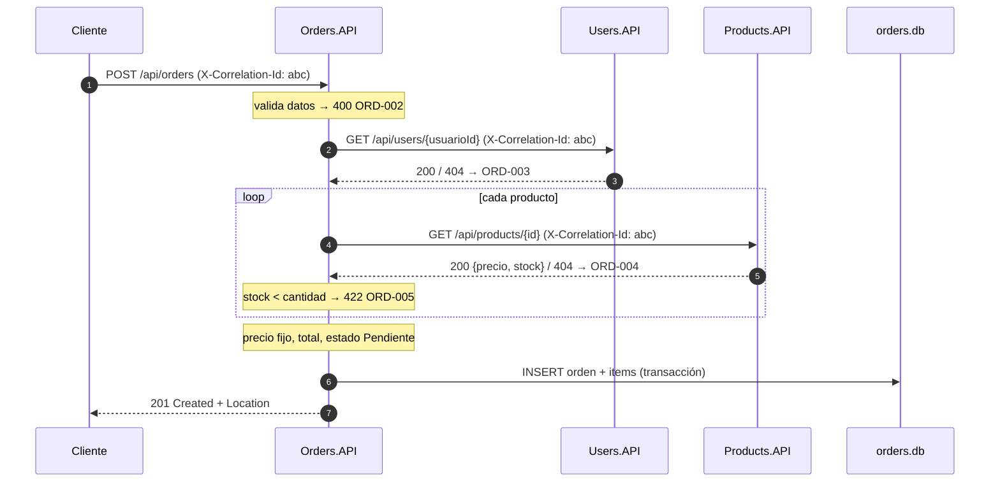

# Arquitectura

Responsable: Rama (paquete C3).

El sistema es un E-Commerce dividido en **5 microservicios** independientes. Cada uno es una REST API en .NET 10, con su propio proceso, su propio puerto y su propia base de datos SQLite. Se comunican solo por HTTP.

## Diagrama



Versión en texto, por si el visor no muestra Mermaid:

```
                         Cliente / Swagger UI
                                  │
     ┌────────────┬───────────────┼─────────────┬───────────────┐
     ▼            ▼               ▼             ▼               ▼
 Products       Users          Orders         Cart        Notifications
  :5001         :5002           :5003         :5004           :5005
 products.db   users.db       orders.db      cart.db     notifications.db

 Llamadas entre servicios (HTTP, siempre con X-Correlation-Id):

   Orders ─────────► Users      validar el usuario            (ORD-003)
   Orders ─────────► Products   producto, stock y precio      (ORD-004, ORD-005)
   Cart ───────────► Products   producto y stock              (CRT-002, CRT-003)
   Notifications ──► Users      validar el destinatario       (NTF-001)
   Products ───────► Orders     órdenes activas antes de borrar (PRD-004)
```

## Servicios

| Servicio | Puerto | Responsabilidad | Llama a | Base |
|---|---|---|---|---|
| Products.API | 5001 | Catálogo de productos (CRUD, filtros por categoría y nombre) | Orders.API | products.db |
| Users.API | 5002 | Registro, login y bloqueo de usuarios | — | users.db |
| Orders.API | 5003 | Órdenes de compra y su ciclo de estados | Users.API, Products.API | orders.db |
| Cart.API | 5004 | Carrito de cada usuario | Products.API | cart.db |
| Notifications.API | 5005 | Registro y envío simulado de notificaciones | Users.API | notifications.db |

## Llamadas entre servicios

| Servicio | Llama a | Para qué | Si el otro responde 404 | Si el otro falla o no responde |
|---|---|---|---|---|
| Orders.API | Users.API `GET /api/users/{id}` | Validar el usuario de la orden | 404 `ORD-003` | 500 `ORD-007` |
| Orders.API | Products.API `GET /api/products/{id}` | Producto, stock y precio | 404 `ORD-004` | 500 `ORD-007` |
| Cart.API | Products.API `GET /api/products/{id}` | Producto y stock | 404 `CRT-002` | 500 `CRT-005` |
| Notifications.API | Users.API `GET /api/users/{id}` | Validar al destinatario | 404 `NTF-001` | 500 `NTF-004` |
| Products.API | Orders.API `GET /api/orders` | Ver si el producto está en órdenes activas antes de borrarlo | — | 500 `PRD-005` |

**Regla común:** antes de leer la respuesta de otro servicio se mira el status HTTP. Un 404 del otro servicio se convierte en el error de negocio del que llama. Cualquier otra falla (5xx, timeout, servicio apagado) es un 500 con el código interno del que llama. El error del otro servicio nunca se reenvía tal cual.

`GET /api/users/{id}` no está en la consigna: es un endpoint **interno** de Users, decidido en el kick-off (ver `docs/servicios/Users.md`).

Users.API no llama a nadie. Que Users llame a Notifications al registrar un usuario (como hacía G17) se descartó: la consigna no lo pide y suma acoplamiento.

## Flujos principales

### Crear una orden (el flujo más largo)



El mismo `X-Correlation-Id` (`abc`) queda en los logs de Orders, Users y Products: buscándolo se ve el recorrido completo.

### Borrar un producto

1. `DELETE /api/products/{id}` → Products verifica que exista (`PRD-001`).
2. Products llama a `GET /api/orders` de Orders y busca el producto en órdenes `Pendiente` o `Confirmada`.
3. Si aparece → 409 `PRD-004`. Si Orders falla o no responde → 500 `PRD-005`, **y el producto no se borra**.
4. Si no aparece → se borra y responde 204.

### Agregar al carrito

1. `POST /api/cart/{userId}/items` → Cart valida la cantidad (`CRT-004`).
2. Cart consulta a Products el producto (`CRT-002`) y el stock, sumando lo que ya había en el carrito (`CRT-003`).
3. Si el producto ya está, suma la cantidad; si no, lo agrega. Actualiza `FechaActualizacion`.

Cart **no** valida el usuario contra Users (brecha 1 de G17): un usuario sin carrito da `CRT-001`.

### Login con bloqueo

1. `POST /api/users/login` con email y contraseña.
2. Credenciales incorrectas → 401 `USR-003`, y se suma un intento fallido.
3. Al acumular 3 intentos fallidos consecutivos, `Activo` pasa a `false` → 403 `USR-004`.
4. Usuario bloqueado manualmente por fraude → 403 `USR-005`.
5. Login correcto → se reinician los intentos y responde 200 con `id`, `nombre`, `apellido` y `email` (nunca `PasswordHash`).

El detalle de la implementación está en `docs/servicios/Users.md`.

## Estructura de cada servicio

Todos siguen la misma plantilla (Products es la referencia):

```
<Servicio>.API/
├── Controllers/        Endpoints HTTP, sin lógica ni try/catch
├── Services/           Lógica de negocio; lanza excepciones de dominio
├── Models/             Entidades que se guardan
├── DTOs/               Requests y responses (el contrato de la consigna)
├── Data/               Interfaz de repositorio + SQLite/Dapper + inicializador
├── Clients/            Clientes HTTP hacia otros servicios (si llama a alguno)
├── Exceptions/         ErrorCodes + NotFound/BusinessRule/Validation
├── ExceptionHandlers/  Un IExceptionHandler por excepción + uno genérico
├── Extensions/         Un archivo por bloque transversal
├── logs/               Archivos JSON de Serilog (no se versionan)
└── Program.cs          Solo compone los bloques, una línea cada uno
```

### Orden del pipeline en `Program.cs`

El orden importa porque cada middleware envuelve a los que vienen después:

```
UseCorrelationId()      1. genera o respeta X-Correlation-Id → ya está en todos los logs
UseRequestLogging()     2. log de inicio; al volver, log de fin con status y duración
UseExceptionHandler()   3. convierte excepciones en respuestas con errorCode
UseSwaggerDocs()        4. /swagger
MapControllers()        5. endpoints
MapHealth()             6. /health, /health/live, /health/ready
```

Si `UseRequestLogging()` fuera después de `UseExceptionHandler()`, el log vería la excepción sin manejar y registraría cada error de negocio como un `Error` 500 (brecha 10 de G17).

## Aspectos transversales

| Aspecto | Cómo se resuelve | Detalle |
|---|---|---|
| Errores | `IExceptionHandler` por tipo + uno genérico, `UseExceptionHandler()` | `docs/errores.md` |
| Logging | Serilog: consola legible + archivo JSON con Servicio, Endpoint, CorrelationId y ErrorCode | `docs/plantilla/logging.md` |
| Trazabilidad | `X-Correlation-Id` propagado con un `DelegatingHandler` | `docs/plantilla/correlation-id.md` |
| Salud | `/health`, `/health/live` (proceso) y `/health/ready` (base y dependencias) | `docs/plantilla/health.md` |
| Documentación | Swagger en `/swagger` con XML comments y ejemplos de error | `docs/plantilla/swagger.md` |
| Persistencia | SQLite + Dapper detrás de una interfaz por servicio | `docs/persistencia.md` |

## Decisiones de arquitectura

- **Una base por servicio.** Ningún servicio lee la base de otro: si necesita un dato, lo pide por HTTP. Así cada servicio se puede cambiar o reiniciar sin tocar a los demás.
- **Persistencia propia.** La cátedra no entregó la librería de persistencia, así que el grupo usa SQLite + Dapper detrás de una interfaz. Los Services solo usan la interfaz, como pide la consigna para la librería.
- **Comunicación síncrona por HTTP.** Es lo que pide la consigna (`IHttpClientFactory`). La contra es que si un servicio cae, los que dependen de él fallan en esas operaciones; eso se hace visible con `ORD-007`/`CRT-005`/... y con `/health/ready` en `Degraded`.
- **Puertos y URLs en `appsettings.json`.** Ningún servicio tiene URLs escritas en el código. Todo es HTTP local, sin desactivar la validación de certificados (brecha 14 de G17).
- **Sin descuento de stock desde Orders.** Mantiene a Products como único dueño de su dato y evita una escritura entre servicios que la consigna no pide.
